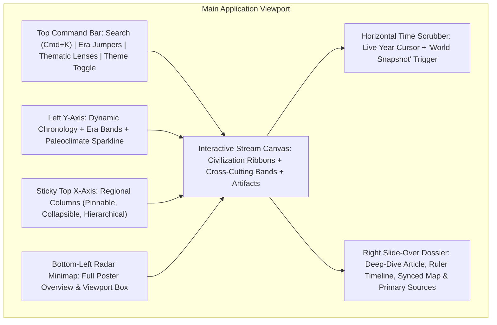
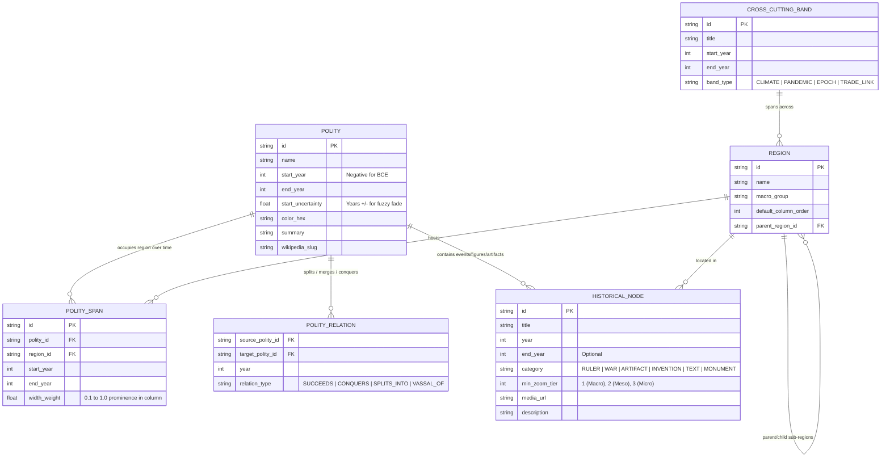

# Interactive World History Timeline: Brainstorm & High-Level Master Plan

---

## 1. Deconstructing the Reference Poster: Strengths vs. Static Limitations

The **UsefulCharts Timeline of World History** succeeds because it combines **chronology (Y-axis)**, **geography (X-axis columns)**, and **geopolitical scale (Sankey-like branching ribbons)** into a single visual field. However, static print imposes fundamental constraints that an interactive web application can overcome:

| Dimension | Static Poster Limitation | Interactive Web App Opportunity |
| :--- | :--- | :--- |
| **Time Resolution** | Fixed grid (100-yr ticks until 1500 CE, then 50-yr ticks). Cannot show both deep prehistory and month-by-month modern revolutions. | **Semantic Zoom ("Powers of Ten")**: Continuous zoom from millennia down to individual years/months, dynamically revealing deeper layers of events. |
| **Geographic Adjacency** | A 2D sphere is flattened into fixed left-to-right columns. Maritime links (e.g., Portugal to Japan, Trans-Atlantic) require long cross-chart lines. | **Reorderable / Pinnable Columns + Synced Map**: Drag any two regions side-by-side (e.g., *Rome vs. Han China*) and pair the timeline with a live historical map. |
| **Information Density** | Capped at ~10 words per callout and tiny thumbnails to avoid visual clutter. | **Progressive Disclosure**: Clean macro silhouette at low zoom; rich portraits, 3D/high-res artifacts, biographies, and primary sources on zoom or click. |
| **Single Analytical Lens** | Dominated by political/dynastic states; trade, climate, technology, and religion are squeezed into sparse annotations. | **Multi-Layered Thematic Lenses**: Toggleable overlays for *Climate & Pandemics*, *Trade Networks*, *Science & Metallurgy*, *Religion & Philosophy*, and *Art*. |
| **Historical Uncertainty** | Early states and migrations look either deceptively sharp or are omitted. | **"Fuzzy History" Visual Grammar**: Gradient fade-ins, hatched confidence intervals, and toggles for competing scholarly chronologies. |

---

## 2. Core Interactive Features & Product Brainstorm

### A. Semantic Zoom & Dynamic Time Warping (Level of Detail / LOD)
Instead of simply scaling a static image larger and smaller, zooming changes *what* information is rendered:
- **Level 1 — Macro Epoch View (Whole Chart)**: Displays only major civilization streams, global macro-eras (Bronze Age, Iron Age, Classical Antiquity), and planetary shocks (*4.2 Kiloyear Event*, *Bronze Age Collapse*, *Black Death*).
- **Level 2 — Century & Dynasty View**: Reveals sub-dynasties (e.g., *Early, Middle, New Kingdom Egypt*; *Spring & Autumn / Warring States*), major trade routes, and iconic monuments/portraits.
- **Level 3 — Decade & Event View**: Expands individual wars, treaties, succession crises, philosophical movements, inventions, and ruler reigns with collision-aware label placement.

### B. The "Synchronism Bar" (Horizontal Time Scrubber)
One of the most magical experiences of a world history chart is asking: *"When the Pyramids were already 1,000 years old, what was happening in Mesoamerica, Britain, and China?"*
- **Interactive Crosshair Ruler**: A horizontal time-cursor follows the user's pointer (or locks onto a specific year, e.g., `221 BCE` or `1279 CE`).
- **Instant World Snapshot Mode**: Clicking a year on the ruler opens a **"World in [Year] CE/BCE" Snapshot Strip** across the top or bottom of the screen, showing active rulers, estimated population, dominant technologies, and active crises in every region at that exact moment.

### C. Synchronized Historical Map & Globe (Dual-Canvas View)
- **Split-Screen / Picture-in-Picture Map**: A collapsible 2D/3D historical map panel synced directly to the horizontal Time Scrubber.
- **Bi-Directional Highlighting**: Hovering over the **Mongol Empire**, **Achaemenid Empire**, or **Roman Empire** ribbon on the timeline highlights its exact territorial extent on the map for that year—and clicking a region on the map scrolls/focuses the corresponding column on the timeline.

### D. Custom Comparative History ("Column Pinning & Folding")
- **Drag, Pin, and Solo Columns**: Users can collapse regions they aren't currently studying or pin any combination of columns side-by-side.
  - *Example Presets*: **"Rome & Han China (Parallel Empires)"**, **"Mesoamerica & Andes"**, **"Steppe Nomads vs. Settled Empires"**, **"The Mediterranean World"**.
- **Hierarchical Sub-Columns**: At macro zoom, "Western Europe" is a single regional column; zooming in smoothly expands it into sub-columns for *Iberia, France, British Isles, Italy, and Germany*.

### E. Thematic Overlay Lenses
Allow users to switch the visual emphasis of the chart like map layers:
1. **Geopolitics & Dynasties (Default)**: Colored streams weighted by territorial/political prominence, showing conquests, splits, and vassal states.
2. **Trade, Migration & Exchange**: Illuminates animated flow lines between columns—*Bronze Age Tin/Copper Routes*, *Indo-European Migrations*, *Austronesian Voyages*, *Silk Road*, *Indian Ocean Monsoon Trade*, *Trans-Saharan Gold/Salt*, and the *Columbian Exchange*.
3. **Climate, Ecology & Pandemics**: Displays a paleoclimate temperature anomaly curve along the vertical axis alongside volcanic winters (*536 CE*), megadroughts (*4.2 ka event*), and pandemics (*Antonine Plague, Justinian Plague, Black Death, 1918 Flu*).
4. **Technology, Writing & Ideas**: Highlights first appearances and diffusion paths of agriculture, bronze, iron, writing systems (cuneiform, hieroglyphs, alphabet, hanzi, Maya script), paper, gunpowder, and printing.

### F. Guided "Story Mode" (Scrollytelling Tours)
For casual learners and students, an overwhelming canvas can be intimidating. Include curated, step-by-step camera tours that pan and zoom across the timeline automatically:
- *"1177 BCE: Unraveling the Bronze Age Collapse"*
- *"The Axial Age (800–200 BCE): When Confucius, Buddha, Socrates, and Zoroaster Reshaped Human Thought Simultaneously"*
- *"How the Mongol Empire Connected the Old World"*
- *"The Columbian Exchange: When Two Hemispheres Collided"*

---

## 3. UI/UX & Visual Design System

### Visual Polish & Micro-Interactions
- **Dual Aesthetic Themes**:
  - **Archival Cartographic (Light)**: Warm parchment background (`#F7F3E8`), subtle antique map watermark, editorial serif headings, high-contrast muted pigment colors for empires.
  - **Obsidian Observatory (Dark)**: Deep slate/charcoal canvas (`#0E1117`) where civilization streams glow with rich jewel tones, making illuminated trade routes and pandemic shockwaves pop.
- **Ribbon Geometry & Lineage Focus**:
  - Hovering over a polity (e.g., *Byzantine Empire*) softly dims unrelated columns (`opacity: 0.25`) while keeping its **ancestors** (*Roman Republic → Roman Empire*), **siblings** (*Western Roman Empire*), and **conquerors/successors** (*Ottoman Empire*) fully illuminated.
- **Command Palette (`Cmd+K` / `/`)**:
  - Instant search for any ruler, empire, artifact, battle, or year (`"44 BCE"`, `"Hammurabi"`, `"Olmecs"`), smoothly animating the camera (`flyTo`) to center on that node.

---

## 4. Data Architecture & Schema Design

To make the web app maintainable, extensible, and filterable, **all visual layout should be data-driven** rather than hardcoded SVG coordinates.

> [!TIP]
> **Procedural Ribbon Layout Engine**: By storing `POLITY_SPAN` (which region a civilization occupies during which years) and `POLITY_RELATION` (how one state branches or merges into another), a custom layout generator can automatically compute smooth SVG/Canvas cubic Bézier ribbons—meaning when a user reorders or hides columns, **the branching empire ribbons dynamically re-route themselves** without breaking!

---

## 5. Recommended Tech Stack & Rendering Architecture

1. **Frontend Framework**: **React 19 + TypeScript + Vite** (or Next.js if SSR/SEO for individual historical entity pages is desired).
2. **Hybrid Rendering Engine (60fps Performance at Scale)**:
   - **Layer 1 — Base Grid, Background Map & Ribbons (HTML5 Canvas 2D / PixiJS or Virtualized SVG)**: Renders the vertical time grid, horizontal era bands, civilization streams, and animated particle trade routes.
   - **Layer 2 — Spatial-Indexed HTML/SVG Overlay (`rbush` R-Tree)**: Renders crisp, accessible typography, artifact thumbnails, and interactive callout pins only for items inside the current camera viewport and zoom tier, using modern CSS (`content-visibility`, CSS Anchor Positioning for popovers, and View Transitions).
3. **Camera & Gesture System**:
   - Smooth inertial pan, pinch-to-zoom (zooming anchored to cursor position), and programmatic `flyTo(year, region, zoomLevel)` camera animations.
4. **State & Data Layer**:
   - Static JSON/SQLite-WASM (or DuckDB-WASM) bundle loaded client-side for zero-latency filtering, instant `Cmd+K` search, and offline capability.
5. **Historical Map Integration**:
   - **MapLibre GL JS** or **D3-Geo** paired with historical boundary GeoJSON snapshots (e.g., adapted from *Historical Basemaps* / *Chronas* / *CShapes*).

---

## 6. Phased Implementation Roadmap

### Phase 1: Foundation & Procedural Stream Canvas (MVP)
- Define the TypeScript data schema (`Regions`, `Polities`, `Spans`, `Transitions`, `Events`, `Epochs`).
- Seed the core dataset matching the reference poster's 11 macro-regions and ~120 major civilizations/empires from 3300 BCE to Present.
- Build the pan/zoom viewport with sticky regional column headers (X-axis) and dynamic chronological ruler (Y-axis).
- Build the procedural Sankey/Bezier ribbon renderer supporting single-column streams, multi-column imperial expansions (Rome, Alexander, Caliphates, Mongols), splits, and merges.

### Phase 2: Interactivity, Semantic Zoom & Deep-Dive Dossier
- Implement the **Horizontal Time Scrubber** and **"World in Year X" Snapshot Panel**.
- Add 3-tier **Semantic Zoom (LOD)** with collision-free placement of artifacts, portraits, battles, and text callouts.
- Build the **Slide-Over Dossier Drawer** (rich articles, ruler lists, predecessor/successor lineage chips, and high-res artifact viewer) + **`Cmd+K` Instant Search**.
- Add the corner **Radar Minimap** and **Archival Light / Obsidian Dark** themes.

### Phase 3: Comparative Tools, Thematic Lenses & Story Mode
- Implement **Column Pinning, Folding, and Reordering** (with live re-routing of cross-column connectors).
- Add **Thematic Lenses** (*Trade & Migration animated flows*, *Climate & Pandemic bands*, *Science & Writing milestones*).
- Create **Guided Scrollytelling Tours ("Story Mode")** with narrated camera waypoints.

### Phase 4: Synchronized Historical Globe/Map & Data Expansion
- Integrate a split-screen **2D/3D Historical Map** synced to the timeline scrubber.
- Add an optional "Deep Prehistory" expansion toggle (10,000 BCE Neolithic Revolution to 3300 BCE) and micro-timelines for dense modern eras.
